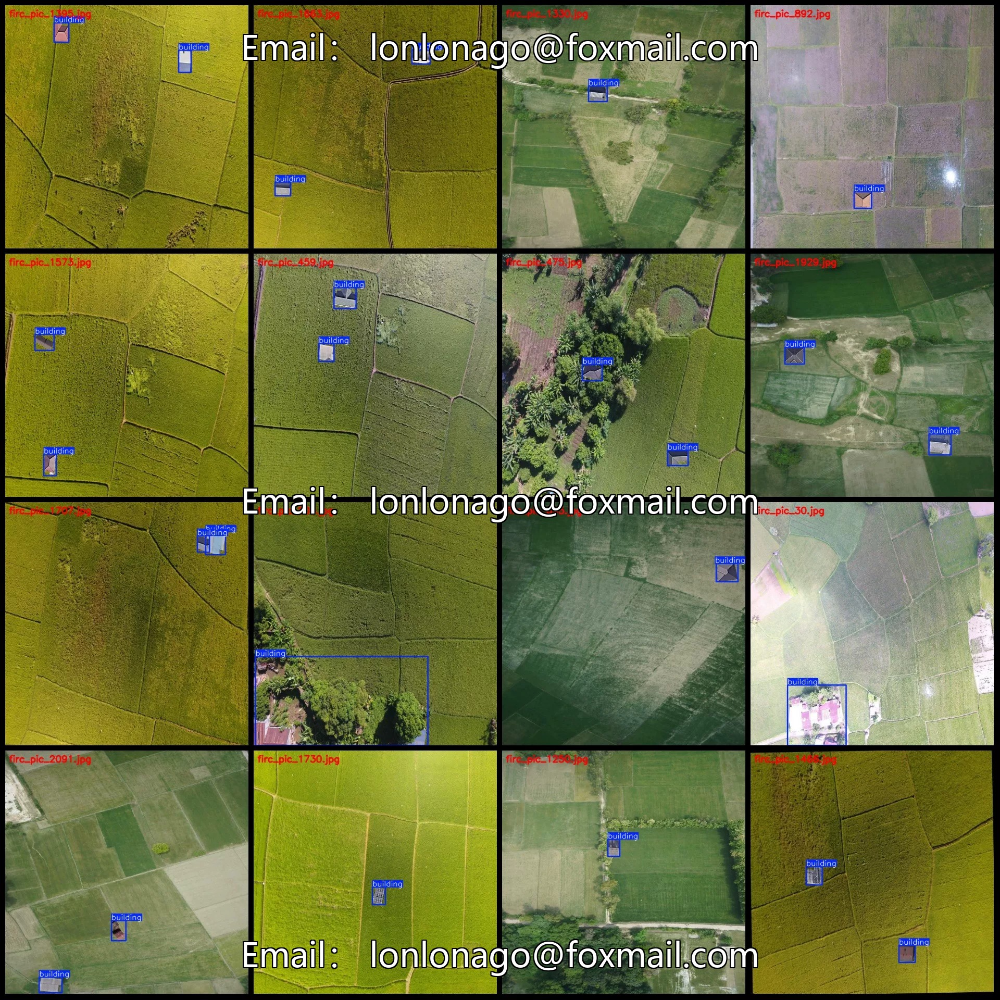
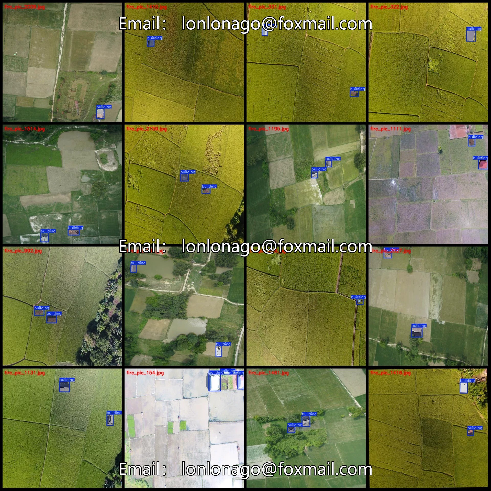
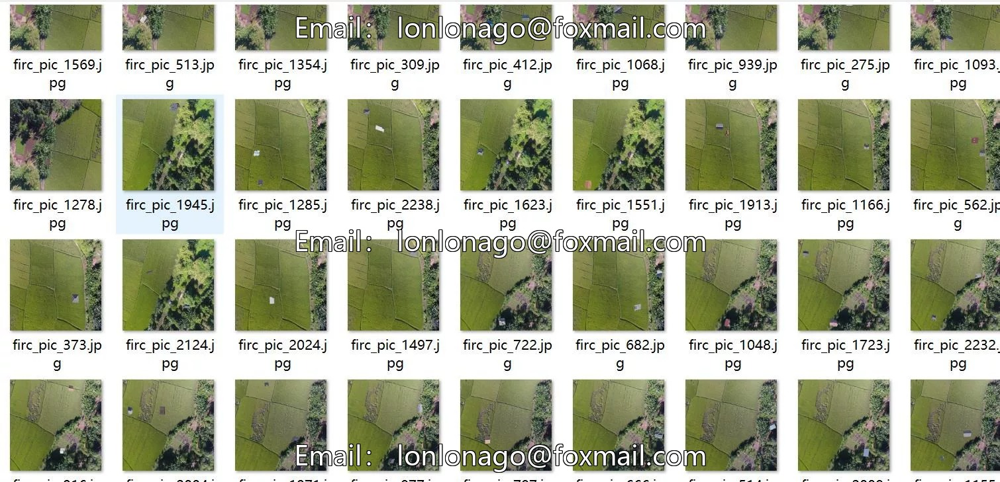
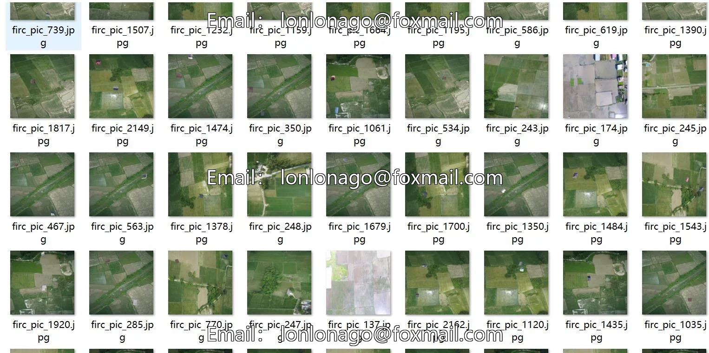

# Drone-view aerial photography of illegal construction in farmland and housing buildings dataset VOC+

## Body

Drone-view aerial photography of illegal constructions in farmland, including buildings and structures. Dataset format: VOC+YOLO, 2249 images, 1 category.
Warm reminder: Due to the dataset's replicability, please confirm compliance before purchasing.
Dataset format: Pascal VOC format + YOLO format (txt file without split path, only contains jpg images and corresponding VOC format xml files and yolo format txt files)
Number of images (number of jpg files): 2249
Number of annotations (number of xml files): 2249
Number of annotations (number of txt files): 2249
Label category count: 1
Category Name: ["building"]
Number of boxes labeled in each category

Number of frames = 3456
Total number of frames: 3456
Number of images per category
Number of images for building = 2249
Image resolution: 640x640
Labeling tool used: labelImg
Labeling rules: Draw a rectangle around the category.
Important note: The dataset does not have separate training, validation, and test sets; you need to partition them yourself.
Special statement: This dataset does not guarantee the accuracy of the trained models or weight files.

## Images

## Payment

Here is a pay link on Stripe ( https://buy.stripe.com/3cs8yP7sY87d0vu9AB ). Please contact me lonlonago@foxmail.com after funding $89, and I will send you a complete data files , thank you!

